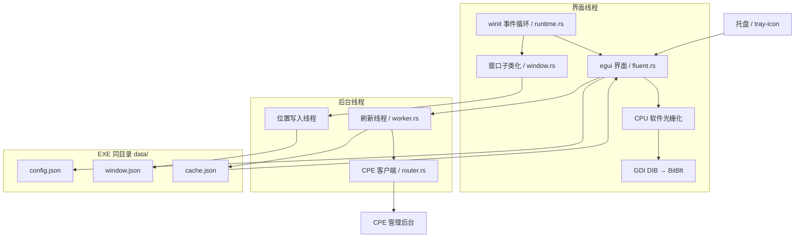

# CPE 流量监控

CPE 流量监控（crate 名 `cpe-monitor`，当前版本 `0.5.2`）是一个面向 Windows 的便携式桌面小组件。程序在局域网内访问 CPE 管理后台，自动完成挑战登录，读取设备侧流量统计，并在小窗口中显示剩余流量、本月已用、总额度、累计用量、更新时间和下次清零日期。剩余额度、进度条和重置倒计时也可以显示在任务栏。

界面使用 Rust + egui 构建，画面由 CPU 软件光栅化后写入 Win32 GDI 的 DIB 缓冲区，再通过 `BitBlt` 呈现到窗口；不使用 WebView、OpenGL/Vulkan/Direct3D，也没有固定帧率渲染循环。程序无安装器，运行数据保存在 EXE 同目录的 `data/`。

> 本文档描述的行为、默认值和限制均以当前仓库源码、`Cargo.toml`/`Cargo.lock`、构建与打包脚本、许可证文件为依据。`config.example.json` 只是空白模板，程序不会读取它。

## 主要功能

- 自动登录 CPE 管理后台：客户端生成 32 字节随机数，校验服务器返回的挑战随机数，使用 PBKDF2-HMAC-SHA256 派生密钥，并校验服务器签名。
- 兼容固件的 `newType=1` 密码哈希升级流程；登录成功后轮换并使用请求验证令牌。
- 按设定间隔自动刷新；可限制仅在指定网络适配器和本机 IPv4 地址下刷新。
- 会话过期时自动重新登录一次；认证失败时停止自动重试，避免反复锁定账号。
- 显示剩余流量、本月已用、总额度、累计用量、更新时间和下次清零日期；离线时保留上次成功读取的缓存数据。
- 窗口按 `340:232` 固定比例缩放，记忆位置和大小；拖动到屏幕工作区边缘时按 `8 DIP` 阈值吸附。
- 支持跟随系统、浅色和深色主题；可从系统字体中选择界面字体，分别设置正文与标题数字字重，并实时预览。
- 托盘菜单支持隐藏/显示窗口、立即刷新、开机自启和退出；双击托盘图标可显示并聚焦窗口。
- 支持窗口置顶、开机自启和单实例运行。
- 密码使用当前 Windows 用户的 DPAPI 加密后保存；数据目录和文件使用受保护 ACL。
- 不写日志文件、不上传遥测，也不包含自动更新逻辑。

## 兼容范围与边界

| 项目 | 说明 |
| --- | --- |
| 目标平台 | Windows。源码直接使用 Win32 API（DPAPI、GDI、窗口子类化、注册表、`ipconfig`），没有其他平台的实现。 |
| 构建产物 | `build.ps1` 将 `cpe-monitor.exe` 复制为仓库根目录的 `CPE-Monitor.exe`。脚本未显式指定 target triple，最终架构取决于构建机的默认目标。 |
| 设备接口 | 按华为 WebUI 风格的 `user/challenge_login`、`user/authentication_login` 和 `monitoring/*` 接口实现，后台用户名固定为 `admin`。不同固件的接口和认证方式可能不同。 |
| 地址限制 | 只接受 `http://` 或 `https://` 加私有/回环 IPv4 地址；不接受域名、IPv6 或 URL 内嵌用户名/密码。 |
| 数据口径 | 数值来自 CPE 设备本地统计，不等同于运营商计费口径。 |
| 运行形态 | 便携目录运行，单实例；无安装器、无自动更新、无遥测上传。 |
| 系统字体 | 不随程序分发。默认字体 `MiSans` 若未安装，会按源码中的回退链使用系统字体和 egui 内置字体。 |

## 技术栈

| 层面 | 实现 |
| --- | --- |
| 语言与版本 | Rust 2024 edition；crate 版本 `0.5.2` |
| 界面 | `egui 0.36.2`（仅 `default_fonts`）、`egui-winit 0.36.2`（剪贴板） |
| 窗口与事件 | `winit 0.30`（`rwh_06`） |
| 渲染 | `vendor/egui_software_backend`（CPU 软件光栅化）、`vendor/epaint 0.36.2` 本地补丁 |
| 呈现 | Win32 GDI：32 位 top-down DIB + `BitBlt`；`SetWindowRgn` 实现圆角裁剪 |
| 系统集成 | `windows-sys 0.61`、`winreg 0.56`、`ipconfig 0.3`、`tray-icon 0.26` |
| 网络 | `reqwest 0.13`（blocking、cookies、native-tls）、`roxmltree 0.21` |
| 序列化 | `serde 1`、`serde_json 1`、`chrono 0.4` |
| 密码学 | `sha2 0.11`、`hmac 0.13`、`pbkdf2 0.13`、`hex 0.4`、`base64 0.22`、`zeroize 1`；DPAPI 通过 `windows-sys` 调用 |
| 字体处理 | `fontdb 0.23`、`ttf-parser 0.25` |
| 图标与资源 | `image 0.25`（png/ico）、`build.rs` + `winresource 0.1` |

发布配置在 `Cargo.toml` 中启用 `opt-level = "s"`、LTO、`codegen-units = 1`、符号剥离和 `panic = "abort"`。

## 整体架构



### 渲染与事件

- `runtime.rs` 实现 `winit` 的 `ApplicationHandler`，通过 `egui-winit` 转换输入，再调用 `egui::Context` 生成图元。
- `egui_software_backend` 以 `ColorFieldOrder::Bgra` 直接写入 32 位 top-down DIB 段；每帧清为不透明黑色，渲染完成后用 `BitBlt(SRCCOPY)` 复制到窗口 DC。
- 窗口尺寸变化时重建绘图表面；宽高必须大于 0 且不超过 16384。
- 程序只在界面变脏或 egui 请求重绘时绘制，使用 `ControlFlow::WaitUntil` 管理截止时间；没有固定帧率或垂直同步循环。
- 窗口不是分层透明窗口；圆角由 `CreateRoundRectRgn` 设置窗口区域实现，并关闭了 winit 的无边框阴影 workaround。
- 隐藏主窗口后释放 DIB、软件渲染纹理、中文字形图集和界面字体数据。后台继续刷新，托盘和任务栏组件仍可工作；重新显示主窗口时按当前设置恢复字体和画面。
- 设置页显示原生标题栏并保留任务栏入口；小组件使用 `WS_EX_TOOLWINDOW` 等样式，不出现在任务栏和 Alt+Tab 列表中。

### 线程与数据流

- **UI/事件线程**：winit 事件循环、egui 界面、窗口样式与区域调整。
- **刷新线程**：`worker.rs` 启动的后台线程，负责定时轮询、网络条件判断、登录与统计读取、写缓存。
- **位置写入线程**：拖动/缩放结束后，`window.rs` 将最终位置经 `mpsc` 交给后台线程写入 `window.json`；移动/缩放消息处理路径中不做渲染或磁盘 I/O。
- **托盘事件**：`tray-icon` 的菜单和双击事件通过回调发送到 UI 线程。
- 线程间使用 `std::sync::mpsc` 传递命令和更新，窗口可见性使用 `Arc<AtomicBool>`。

### 刷新流程

- 启动后立即尝试一次读取；之后每次成功后等待 `interval` 分钟。
- `worker` 最多每 15 秒检查一次命令队列，因此“立即刷新”和保存设置的响应不会超过约 15 秒的等待窗口。
- 网络条件不匹配时暂停刷新并每 15 秒复查；地址或密码为空时每 60 秒提示一次，不发起网络请求。
- 认证失败后进入暂停状态，不再自动重试；保存设置（`Configure`）会重置路由器客户端并立即重试。
- 会话过期错误会触发一次重新登录后重试读取。
- 每次成功读取都会原子写入 `cache.json`，UI 中的“缓存”时间来自该快照。

### 网络访问约束

- 请求客户端禁用系统代理（`no_proxy`）、启用内存 Cookie 存储、禁止重定向。
- 连接超时 4 秒，整体超时 8 秒。
- 首页 HTML 读取上限 1 MiB，接口 XML 响应上限 64 KiB；超限、非 UTF-8 或非 XML 都会报错。
- 只调用登录和统计接口；除登录握手外，不调用路由器配置写接口。

## 模块职责

| 文件 | 职责 |
| --- | --- |
| `src/main.rs` | 进程入口、命令行参数、数据初始化、单实例互斥、`App` 状态机、设置保存、托盘菜单、截图模式 |
| `src/runtime.rs` | winit + egui-winit 事件循环、egui 上下文、软件光栅化、GDI DIB 表面、重绘调度、窗口圆角与任务栏/主题设置 |
| `src/taskbar.rs` | 主任务栏与通知区域定位、透明 GDI 绘制、颜色和缩放适配 |
| `src/window.rs` | Win32 窗口子类化、原生命中测试、标题拖动、等比缩放约束、边缘吸附、窗口样式、位置持久化 |
| `src/router.rs` | CPE HTTP 客户端、CSRF 令牌、挑战登录与服务器签名校验、统计接口解析、额度/清零日解析、错误分类 |
| `src/worker.rs` | 后台刷新线程、命令处理、网络条件检查、认证暂停、缓存写入、UI 重绘通知 |
| `src/model.rs` | `Config`/`Snapshot` 数据模型、默认值与校验、数据目录、DPAPI 加解密、地址校验、开机自启、网卡枚举、清零日计算、单位格式化 |
| `src/storage.rs` | `data/` 目录初始化、受保护 ACL、重解析点拒绝、原子写入、读取大小限制 |
| `src/fluent.rs` | 小组件与设置页布局、Fluent 风格配色、主题/字体应用、字体枚举与预览、字体诊断报告 |
| `build.rs` | 将 `CTM.ico` 及产品名称/描述写入 Windows 资源 |
| `build.ps1` | 发布构建：独立 Cargo 缓存/目标目录、路径重映射、复制 EXE |
| `tools/package_release.py` | 生成仅含运行文件和许可通知的便携 ZIP |
| `vendor/` | 本地软件光栅器、`constify` 依赖和 `epaint` 补丁；缺少内容无法构建 |
| `config.example.json` | 空白配置模板，不参与运行 |

各模块内含单元测试，覆盖日期计算、私网地址校验、DPAPI 往返、XML 错误解析、额度单位解析、窗口缩放/吸附、存储 ACL 与原子替换等。

## 从源码构建

### 环境要求

- Windows。
- Rust 工具链：项目使用 2024 edition，至少需要 Rust 1.85；`Cargo.toml` 未声明 `rust-version`，锁定依赖可能要求更高版本，建议使用当前稳定版。
- MSVC 工具链与 Windows SDK；`build.rs` 通过 `winresource` 编译图标资源，需要可用的 Windows 资源编译器。
- PowerShell。
- 首次构建需要联网下载 `Cargo.lock` 锁定的依赖。
- 仓库中的 `vendor/` 必须完整存在：`Cargo.toml` 对 `egui_software_backend` 使用 path 依赖，并通过 `[patch.crates-io]` 用 `vendor/epaint` 覆盖上游 `epaint`。

### 使用构建脚本

在仓库根目录运行：

```powershell
.\build.ps1
```

脚本会：

1. 将 `CARGO_HOME` 指向 `.build/cargo-home`，将 `CARGO_TARGET_DIR` 指向 `.build/target`。
2. 设置 `CARGO_ENCODED_RUSTFLAGS`，将 `$env:USERPROFILE` 重映射为 `/user`、仓库路径重映射为 `/src`，避免把构建者用户名和源码目录写入 EXE。
3. 执行 `cargo build --release --locked`。
4. 将 `.build/target/release/cpe-monitor.exe` 复制为仓库根目录的 `CPE-Monitor.exe`。

指定其他构建缓存目录：

```powershell
.\build.ps1 -BuildDirectory "D:\BuildCache\CPE-Monitor"
```

注意：脚本会覆盖调用进程中的 `CARGO_HOME`、`CARGO_TARGET_DIR` 和 `CARGO_ENCODED_RUSTFLAGS`；如需自定义 Cargo 参数，请直接使用 `cargo` 或修改脚本。

### 直接使用 Cargo

```powershell
cargo build --release --locked
```

产物位于 `target/release/cpe-monitor.exe`。这种方式不会应用 `build.ps1` 中的路径重映射，也不会自动复制到仓库根目录。

### 检查与测试

```powershell
cargo check --locked
cargo test --locked
```

测试需要在 Windows 交互式桌面环境运行：窗口测试会创建隐藏的原生窗口，存储测试会创建带 ACL 的临时数据文件。测试数据位于测试程序所在目录的 `data/` 下。

## 运行与使用

1. 将构建产物或便携包放到有写入权限的普通文件夹（不要放在需要管理员权限才能写入的目录）。
2. 双击 `CPE-Monitor.exe`。首次启动会创建 `data/config.json` 和默认配置。
3. 鼠标移到小组件上，点击右上角齿轮按钮打开设置。
4. 填写 CPE 的 HTTP/HTTPS 地址和管理后台密码，按需调整刷新间隔、网络条件、主题、字体和其他选项，保存后开始读取。

路由器地址可以粘贴完整后台地址（例如以 `/#/statistic` 结尾的页面）；程序只保留 `scheme://IPv4[:port]` 部分。密码输入框留空表示保留已保存的密码；首次配置必须填写密码。**不要在 JSON 中直接写入明文密码。**

### 窗口操作

- 拖动顶部标题区域移动窗口；右侧按钮区域不参与标题拖动。双击标题不会最大化。
- 在标题区域右键可打开上下文菜单：立即刷新、设置、退出。
- 拖动四条边或四个角进行等比缩放，比例为 `340:232`；宽度范围 `221–680 DIP`（约为初始尺寸的 65%–200%），高度随比例计算。
- 松开鼠标后，最终位置和尺寸由后台线程保存到 `window.json`。
- 靠近显示器工作区边缘约 `8 DIP` 时吸附；继续拖动可脱离。
- 设置页为固定 `420×660` 大小，会尽量保持在当前显示器工作区内；按 `Esc`、点击关闭或“取消”都会返回小组件并恢复其位置。
- 悬停时显示“设置”和“隐藏到托盘”按钮；若托盘创建失败，隐藏按钮会改为最小化窗口。
- 托盘菜单包含“隐藏窗口/显示窗口”“立即刷新”“开机自启”和“退出”；双击托盘左键可显示并聚焦窗口。
- 小组件不显示在任务栏或 Alt+Tab 列表中；设置页保留常规任务栏入口。

### 显示内容

**在任务栏查看流量**。打开齿轮设置，启用“在任务栏显示剩余流量”，选择“通知区域旁”或“任务栏左侧”。水平偏移使用 DIP，正数向右，负数向左。可以边调边看，点击“保存”记住位置和字体，“取消”恢复原设置。单独修改任务栏设置时可以离线保存。

任务栏组件使用主屏横向任务栏，支持单独选字体或沿用主窗口字体，文字根据任务栏背景明暗切换。透明区域和文字都允许鼠标点击穿透。组件按通知区域边界定位，使用手动偏移避开其他组件。打开托盘菜单隐藏主窗口后，仍可查看最后一次读取的额度和距清零的天数。

从 0.5.1 起，组件作为任务栏的透明子窗口显示，点击图标时随任务栏一起保持层级。文字颜色取自多个背景位置；图标局部高亮或菜单遮挡时会保留原有颜色。

0.5.2 将任务栏字号调为 14 DIP，按屏幕缩放绘制。重绘时对文字区域做灰度超采样，分别处理浅色和深色文字的边缘，再合成到透明背景。临时位图用完即释放，静止时沿用已绘制的画面。

- 顶部显示 CPE 主机和“已连接/未更新”状态。
- “剩余流量”为总额度减去本月已用，最小为 0；低于总额度 10% 时使用警示色。
- 进度条显示剩余比例；“已用”为本月下载与上传之和；“共”为总额度。
- “下次清零”显示下一次清零日期和剩余天数；若本月清零日已到（含当天），显示下个月对应日期；短月自动取该月最后一天。
- 底部显示“更新/缓存”时间与累计用量；悬停底部状态区域可查看当前状态、最近成功读取时间和数据来源说明。
- 没有总额度时显示“额度未设置”；没有快照时显示“等待首次读取”。

## 命令行参数

正常使用无需参数。以下参数均由源码解析：

| 参数 | 作用 |
| --- | --- |
| `--settings` | 启动后直接打开设置页，而不是小组件。 |
| `--probe` | 读取已保存配置，执行地址校验、登录和一次统计刷新；成功时写入 `cache.json`，并写入 `probe.json` 报告。 |
| `--font-report` | 检查 `MiSans`、`Microsoft YaHei`、`Segoe UI` 的常规/半粗字面信息，写入 `font-report.json`。 |
| `--capture=<路径>` | 截图模式：不启动刷新线程和托盘，等待指定延迟后保存窗口截图并退出。 |
| `--capture-delay=<秒>` | 截图延迟，默认 3 秒，限制在 3–120 秒。 |
| `--capture-hover` | 截图时强制显示悬停按钮。 |
| `--capture-weights` | 截图设置页时滚动到字重区域。 |
| `--preview-theme=<值>` | 仅截图模式有效，临时覆盖主题。 |
| `--preview-scale=<值>` | 仅截图模式有效，临时覆盖 `ui_scale`。 |
| `--preview-font=<名称>` | 仅截图模式有效，临时覆盖字体。 |

正常运行（非截图模式）会创建命名互斥量 `Local\CPE-Monitor-7AA151C7`；已有实例时新实例直接退出。`--probe` 和 `--font-report` 在互斥检查之前执行。

## 配置项说明

程序首次运行时会根据 `Config::default()` 生成 `data/config.json`。配置使用 `serde(default)`：缺失字段取默认值，未知字段会被忽略。`config.example.json` 的内容如下，可作为手工编辑参考：

```json
{
  "router": "",
  "password": "",
  "theme": "system",
  "interval": 10,
  "adapter": "",
  "ip": "",
  "font": "MiSans",
  "font_weight": 400,
  "heading_weight": 600,
  "ui_scale": 1.0,
  "autostart": false,
  "topmost": false,
  "taskbar": { "enabled": false, "side": "right", "offset": 0, "font": "" },
  "quota_gb": null,
  "reset_day": null,
  "position": null
}
```

| 字段 | 类型 | 默认值 | 说明 |
| --- | --- | --- | --- |
| `router` | 字符串 | `""` | 管理后台地址。必须是 `http://` 或 `https://`，主机必须是私有或回环 IPv4；URL 内不能含用户名/密码。只保留 `scheme://host[:port]`，路径、查询和片段会被丢弃。 |
| `password` | 字符串 | `""` | DPAPI 密文的 Base64 文本，不能填写明文。空值表示尚未保存密码；保存设置时输入框留空会沿用旧值，若最终仍为空则拒绝保存。 |
| `theme` | 字符串 | `"system"` | `system`、`light` 或 `dark`；其他值按 `system` 处理。 |
| `interval` | 整数 | `10` | 自动刷新间隔，单位分钟，范围 1–1440。 |
| `adapter` | 字符串 | `""` | 网络适配器友好名称；空表示不限。设置页下拉框列出系统适配器及其 IPv4 地址。匹配为精确字符串比较；选中的适配器没有 IPv4 时条件不成立。 |
| `ip` | 字符串 | `""` | 本机 IPv4 过滤条件；空表示不限；非空必须是合法 IPv4。 |
| `font` | 字符串 | `"MiSans"` | 界面字体族名，来自系统已安装字体；枚举时排除以 `@` 开头的名称。字体未安装或缺少中文字形时按回退链处理。 |
| `font_weight` | 整数 | `400` | 正文字重，范围 100–900。 |
| `heading_weight` | 整数 | `600` | 标题和数字字重，范围 100–900。 |
| `ui_scale` | 浮点数 | `1.0` | 范围 0.75–1.25，必须是有限数。仅在 `window.json` 不存在时作为小组件初始尺寸比例（`340×232 DIP × ui_scale`）；之后实际缩放由窗口宽度决定（限制在 0.65–2.0）。设置页不提供该项。 |
| `autostart` | 布尔 | `false` | 开机自启。写入或删除 `HKCU\Software\Microsoft\Windows\CurrentVersion\Run` 下的 `CPE-Monitor` 值，内容为带引号的当前 EXE 路径。 |
| `topmost` | 布尔 | `false` | 窗口始终置顶。 |
| `taskbar` | 对象 | 见上方模板 | `enabled` 控制显示，`side` 为 `right`（通知区旁）或 `left`，`offset` 是水平偏移 DIP，`font` 留空时跟随界面字体。旧配置自动使用默认值。 |
| `quota_gb` | 数字或 `null` | `null` | 手动指定的每月额度（GB），覆盖设备值；必须有限且大于 0。设置页范围为 0.01–1,000,000。 |
| `reset_day` | 整数或 `null` | `null` | 手动指定的每月清零日，范围 1–31，覆盖设备返回的 `StartDay`。 |
| `position` | `[数字, 数字]` 或 `null` | `null` | 启动时传给视口的初始位置坐标；程序不会写回该字段。实际窗口位置和尺寸保存在 `window.json`。 |

### 保存时的校验与顺序

单独更改任务栏选项时仅写入配置。保存其他设置时依次执行：

1. 解析刷新间隔文本，必须是 1–1440 的整数。
2. 校验字重、`ui_scale`、地址、刷新间隔、IP、清零日和额度。
3. 若输入了新密码，调用当前用户 DPAPI 加密并写入 `password`。
4. 若最终没有密码，拒绝保存。
5. 先应用开机自启；若随后写配置失败，会回滚自启状态。
6. 原子写入 `config.json`，更新托盘“开机自启”勾选状态，向刷新线程发送新配置并关闭设置页。

保存失败时错误显示在设置页底部，原配置保持不变。

### 额度与清零日来源

每次读取统计时，总额度按以下优先级选择：

1. 配置中的 `quota_gb`（转换为 `GB × 1024³` 字节）。
2. 设备 `monitoring/start_date` 返回的 `trafficmaxlimit`（有限且大于 0）。
3. 同接口返回的 `DataLimit` 字符串，支持 `TB`、`GB`、`MB`、`KB`、`B` 后缀或纯数字。

清零日按以下优先级选择：

1. 配置中的 `reset_day`（1–31）。
2. 设备 `monitoring/start_date` 返回的 `StartDay`（1–31）。

两者都缺失时，界面显示“额度未设置”或“未设置”。手动覆盖只影响小组件显示，不会修改路由器配置。

### 主题与字体

- 主题支持跟随系统、浅色和深色；设置页修改后经约 180 ms 防抖应用到界面。
- 正文字重和标题/数字字重分别可设 100–900。可变字体使用字体的 `wght` 轴并限制在轴范围内；静态字体按 PostScript 名称和字重选择最接近的已安装字面。
- 设置页字体下拉框支持搜索；选择后显示 `Aa 中文 · CPE 流量监控`、`123.45 GB` 和静态字体说明的预览。
- 取消设置会恢复已保存的外观；字体和主题在保存后才写入配置。

## 数据存储与安全

### 数据位置

所有运行数据位于 **EXE 同目录的 `data/`**：

| 文件 | 内容 | 写入时机 |
| --- | --- | --- |
| `config.json` | 地址、密码密文、刷新条件、主题、字体、自启、置顶、额度/清零日覆盖值、`ui_scale`、`position` | 首次运行创建；保存设置时原子替换 |
| `window.json` | 窗口位置与尺寸（`x`、`y`、`width_dip`、`height_dip`） | 拖动或缩放结束后由后台线程写入 |
| `cache.json` | 最近一次成功读取的 `Snapshot`（已用、总额度、累计、清零日、更新时间） | 每次刷新成功或 `--probe` 成功时 |
| `probe.json` | `--probe` 的诊断结果 | 主动运行 `--probe` 时 |
| `font-report.json` | `--font-report` 的字体信息 | 主动运行 `--font-report` 时 |

`window.json` 加载时会校验宽度在 221–680 DIP 之间，且宽高比与 `340:232` 的偏差小于 0.02；不合法时回退到默认尺寸。`cache.json` 在启动时读取，用于离线显示。

### 路径与 ACL

- 启动时检查数据目录及其所有祖先路径，拒绝符号链接和目录联接（重解析点）。
- 创建 `data/` 后，为目录和其中已有文件设置受保护 DACL，仅当前用户 SID 和 `SYSTEM` 拥有完全访问权；后续新建文件也应用同样限制。
- 权限设置失败会中止启动，不会降级为公开保存。
- 读写前再次检查目标路径不是重解析点；读取大小上限为 1 MiB。
- 数据文件名禁止包含 `/`、`\` 或为 `..`。

### 原子写入

写入流程为：生成随机临时文件名 → `create_new` 排他创建 → 设置 ACL → 完整写入 → `sync_all` → 原子重命名替换目标文件。失败时删除临时文件，避免留下半写状态。

### 密码保护

- 保存时调用当前用户作用域的 `CryptProtectData`（`CRYPTPROTECT_UI_FORBIDDEN`），输出二进制经 Base64 后写入 `password` 字段。
- 解密使用 `CryptUnprotectData`；应用拥有的密码缓冲区、DPAPI 输出和主要派生密钥在释放前清零。
- 启动时会尝试解密已保存密码以验证可用性；设置页不会回填明文，留空表示保留旧密码。
- 密码输入框每帧清除撤销历史，降低误操作泄露风险。
- 更换电脑或 Windows 账户后，DPAPI 密文无法解密，需要在设置中重新输入密码。

### 网络与接口安全

- 地址必须是私有或回环 IPv4 的 HTTP/HTTPS 地址；拒绝域名、IPv6 和 URL 内嵌凭据。
- 请求绕过系统代理并禁止重定向，连接/整体超时分别为 4 秒和 8 秒。
- Cookie 和请求验证令牌只保存在内存中；程序不写会话日志。
- 错误提示不包含请求 URL、原始响应或任意服务器错误文本；服务器错误码会被映射为固定中文提示。
- 认证失败会停止自动重试；会话冲突类错误会提示退出管理网页后重试。
- 除登录握手外，程序只读取统计接口，不调用配置写接口。

### 已知限制

- DPAPI 和 ACL 保护静态文件，不能防御同一账户下的恶意程序或管理员提权。
- HTTP 后台的会话和统计仍会在局域网明文传输；使用 SCRAM 登录不等于启用了 HTTPS。
- 应用内仍可能存在库产生的短暂明文副本；交换文件、崩溃转储和系统备份不在保护范围内。
- 程序不提供遥测、自动更新或远程配置。

### 重置数据

退出程序后删除 EXE 同目录的 `data/`，下次启动会重新创建默认配置。开机自启记录位于注册表 `HKCU\Software\Microsoft\Windows\CurrentVersion\Run`，不会随 `data/` 删除；如需彻底清理，先在设置或托盘中关闭开机自启。

## 打包发布

构建完成后，可使用 Python 3.7 及以上版本打包便携 ZIP（仅打包需要 Python，运行程序不需要）：

```powershell
python tools/package_release.py --exe CPE-Monitor.exe --output dist/CPE-Monitor-Windows-x64.zip
```

参数：

| 参数 | 默认值 | 说明 |
| --- | --- | --- |
| `--source-root` | 脚本所在仓库根目录 | 许可证、通知和 `vendor/` 的查找根目录 |
| `--exe` | `<仓库根>/CPE-Monitor.exe` | 要打包的 EXE |
| `--output` | `<仓库根>/dist/CPE-Monitor-Windows-x64.zip` | 输出 ZIP |
| `--directory` | 无 | 额外创建一个尚不存在的暂存目录，写入与 ZIP 相同的文件 |

打包脚本会：

- 收集 `LICENSES/third-party/**` 和 `vendor/**/LICENSE*` 下的许可文件。
- 将内容完全相同（按 CRLF 归一化后计算 SHA-256）的许可正文合并为一个章节，同时保留每个原始文件路径和版权信息。
- 生成 `THIRD_PARTY_LICENSES.txt`，并把 `THIRD_PARTY_NOTICES.md` 中的本地许可链接改写为对应章节。
- 将 `LICENSES/GPL-3.0.txt` 重命名为包内的 `LICENSE-GPL-3.0.txt`，并调整 `NOTICE` 中指向 `vendor/README.md` 的说明。
- 校验每个原始许可正文都完整出现在合并文件中，校验 ZIP 可读且文件集合与预期一致。
- 先写临时 ZIP，再原子替换目标文件，最后输出 JSON 统计信息（原始许可文件数、去重后正文数、文件数、解压后大小和 ZIP 大小）。

便携包只包含以下 6 个文件：

```text
CPE-Monitor.exe
LICENSE
LICENSE-GPL-3.0.txt
NOTICE
THIRD_PARTY_NOTICES.md
THIRD_PARTY_LICENSES.txt
```

不包含 `data/`、配置模板、图标源文件、开发文档、Cargo 缓存或构建组件；`data/` 由程序首次运行时创建。

发布前建议确认：

- 从当前源码和锁文件重新构建 EXE。
- 随二进制提供适用的 GPL 与第三方许可证、版权和修改说明。
- 按 GPL 要求提供对应源码或获取方式。
- 不把个人 `data/`、会话令牌、诊断文件或本机日志打进发布包。
- 对外分发前确认 `CTM.ico` 的使用权。

## 故障排查

| 现象或提示 | 排查方向 |
| --- | --- |
| “请在设置中填写路由器地址和后台密码” | 配置缺少地址或密码；打开设置填写并保存。 |
| “连接超时”“无法连接 CPE”“CPE 网络请求失败” | 确认电脑处于 CPE 所在网络、地址正确；检查适配器/IP 刷新条件；连接超时为 4 秒、整体超时为 8 秒。 |
| 地址校验失败 | 使用完整的 `http://` 或 `https://` 地址；主机必须是私有或回环 IPv4，不能是域名、IPv6 或含用户名/密码的 URL。 |
| “密码错误，已停止自动重试” | 错误码 108001/108002/108006；修改密码并保存设置，或重启程序后重试。 |
| “CPE 暂时限制登录，已停止重试” | 错误码 108007/108010；稍后重新保存设置再试。 |
| “CPE 提示已有会话” | 错误码 108003/108005/108009；退出 CPE 管理网页后重试。 |
| “网络条件不匹配 · 已暂停刷新” | 当前网卡或本机 IP 不满足设置；清空条件或切换到正确网络。 |
| 额度或清零日显示“未设置” | 固件未返回 `trafficmaxlimit`/`DataLimit`/`StartDay`；可在“套餐设置”中手动覆盖。 |
| 字重变化不明显 | 字体可能只有静态字面，或可变字体没有可用的 `wght` 轴；尝试安装多字重字体。 |
| “配置初始化失败”“无法限制数据文件权限” | 将程序放到当前用户可写的普通文件夹；检查路径是否为符号链接/目录联接；检查 `config.json` 格式。 |
| “config.json 格式损坏，原文件已保留” | 程序不会覆盖损坏文件；先备份 `data/`，再修正或删除配置。 |
| 托盘图标没有出现 | 托盘创建失败时程序仍可运行，隐藏按钮会改为最小化；查看系统托盘溢出区或重启程序。 |
| 第二个实例没有窗口 | 正常运行使用单实例互斥；使用已运行实例的齿轮打开设置，或先退出旧实例。 |
| “CPE 返回了非 XML 数据”“CPE 返回编码异常”“CPE 响应过大” | 固件接口不兼容或返回内容异常；确认设备型号/固件和接口行为。 |
| “接口缺少字段 …”“接口数值异常 …” | 固件统计字段缺失或格式不同；当前实现的接口字段不匹配。 |
| “无法读取本机密码，请到设置重新输入” | DPAPI 密文与当前 Windows 用户/电脑不匹配；重新输入密码。 |
| 隐藏窗口后仍在刷新 | 主窗口停止绘制并释放渲染资源；后台刷新继续为托盘模式和任务栏组件提供数据。 |

反馈问题时请提供 Windows 版本、设备/固件信息、界面错误提示和复现步骤。不要提交真实密码、`data/`、会话令牌或包含个人网络信息的诊断文件。

## 许可证与第三方声明

Copyright (C) 2026 CPE Monitor contributors.

### 项目代码

- `Cargo.toml` 将本项目许可证声明为 `GPL-2.0-or-later`；`NOTICE` 同样给出 SPDX 标识，并说明可按 GNU GPL version 2 或后续版本使用。
- 仓库根目录的 `LICENSE` 是 GNU General Public License version 2 正文；GNU GPL version 3 正文位于 `LICENSES/GPL-3.0.txt`。
- `NOTICE` 明确说明：包含当前 Apache-2.0 依赖的组合程序按 GPL version 3 分发。因此不应把当前完整二进制简单标注为仅 GPL v2。
- 软件按现状提供，不提供担保。

### 第三方组件

- 锁定依赖、版本、上游许可证表达式和包内许可文本见 `THIRD_PARTY_NOTICES.md`。
- 第三方代码和字体保留各自授权，不会因本项目采用 GPL 而被重新授权。
- 对 `MIT OR Apache-2.0` 等任选授权，可按兼容分支使用；含 `AND` 的组件必须同时满足各项条件。
- egui 内置字体涉及 OFL、Ubuntu Font Licence 和字体图标 MIT 授权；系统字体不由仓库打包或重新分发。
- `vendor/README.md` 记录软件光栅器和 `epaint` 补丁的上游仓库、修订号、许可证及本地修改；对应许可正文随 `vendor/` 保存。
- `CTM.ico` 是用户提供的图标，`NOTICE` 说明其不随项目代码许可证变更而重新授权；对外分发前应确认图标使用权。

分发修改版或二进制时，应附相应许可证、版权与修改说明，并按适用 GPL 条款提供对应源码和构建所需文件。发布包不应包含个人 `data/`、Cargo 缓存或本机日志。
